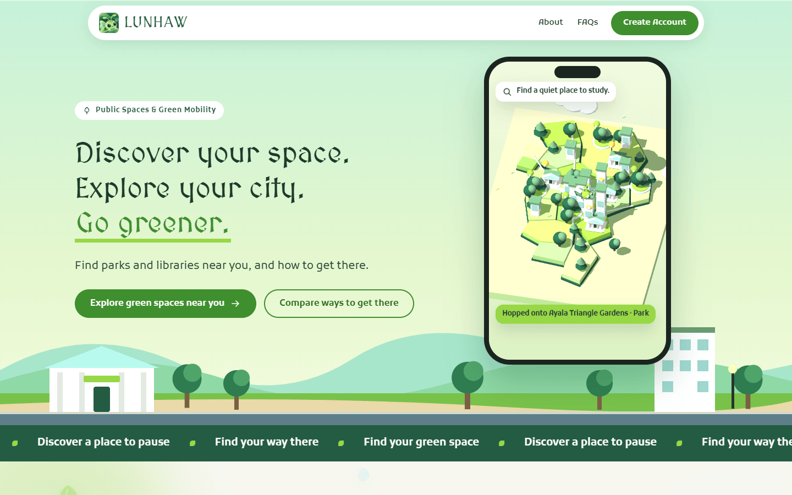
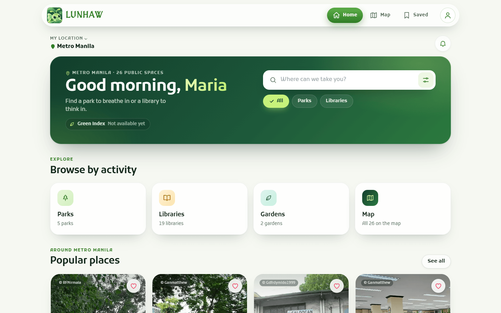
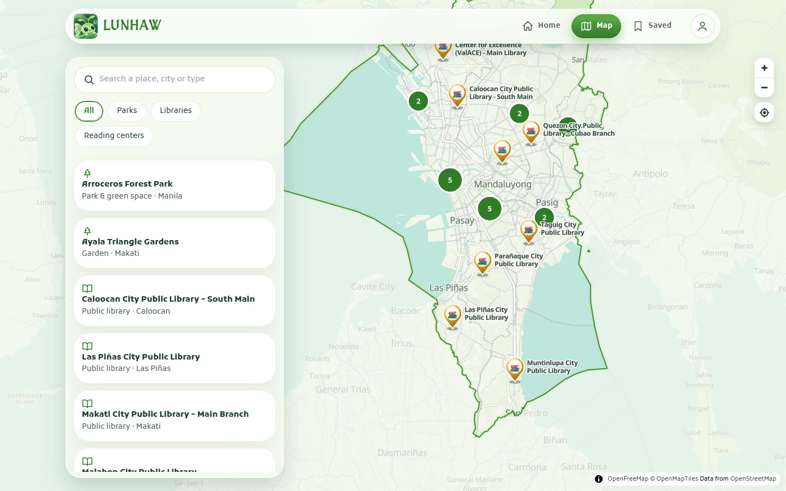
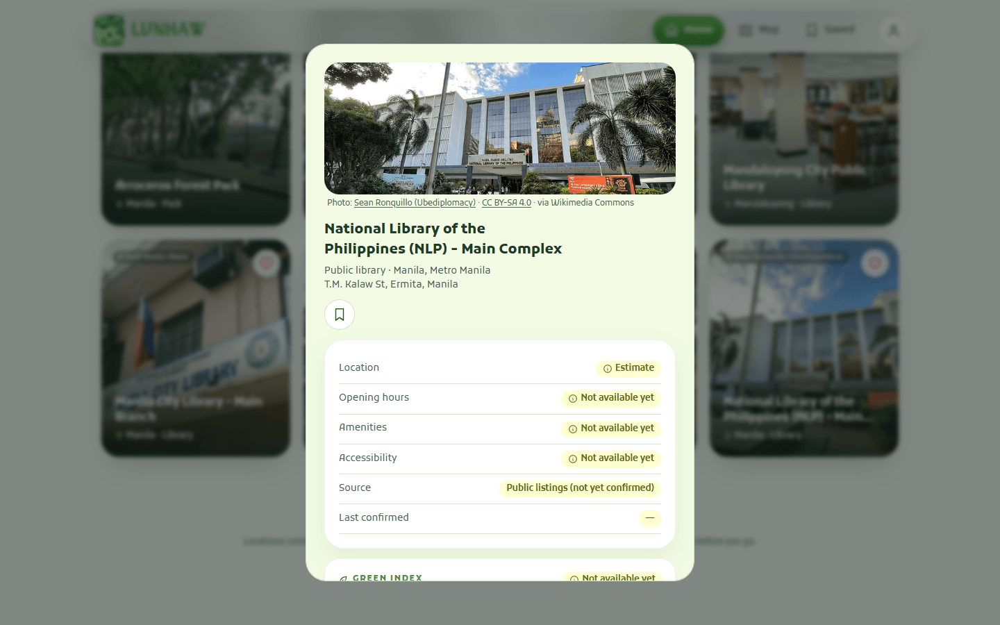
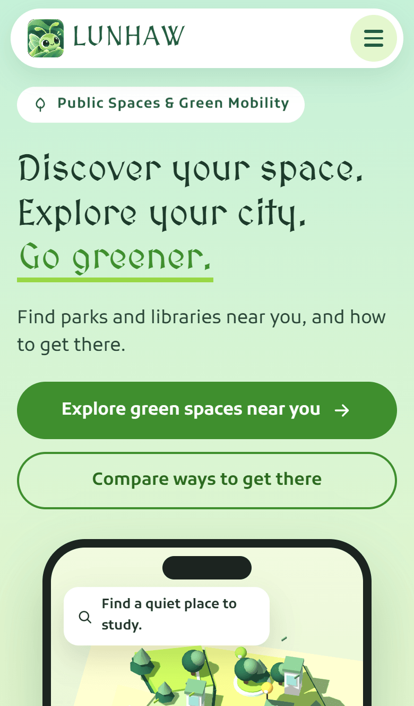
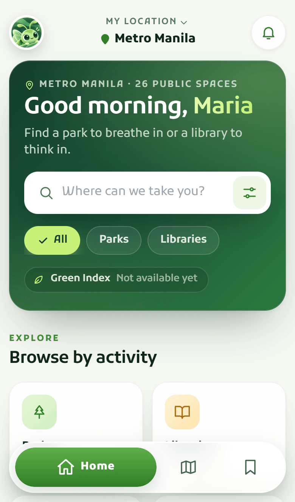
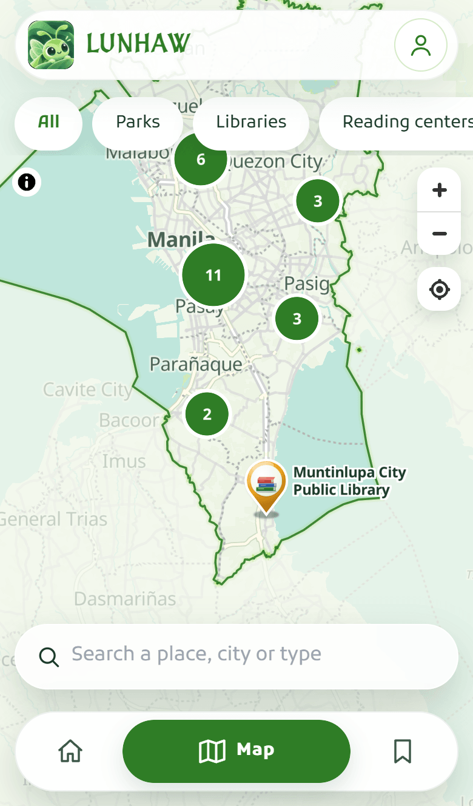
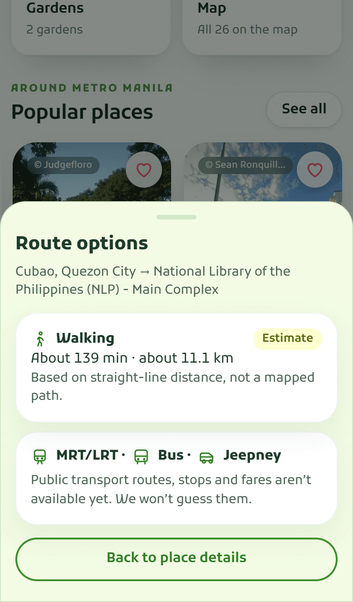

 <p align="center">
  
</p>

<h1 align="center">Lunhaw</h1>

<p align="center">
  <b>Discover your space. Explore your city. Go greener.</b><br>
  Discover public parks, gardens, libraries, and reading centers across Metro Manila,<br>
  and find more accessible ways to explore the city.
</p>

<p align="center">
  <a href="https://nextjs.org/"></a>
  <a href="https://react.dev/"></a>
  <a href="https://www.typescriptlang.org/"></a>
  <a href="https://supabase.com/"></a>
  <a href="https://vitest.dev/"></a>
  <a href="https://playwright.dev/"></a>
  <a href="https://pnpm.io/"></a>
</p>

<p align="center">
  
  
  
  
  
</p>

<p align="center">
  <a href="#about">About</a> ·
  <a href="#screenshots">Screenshots</a> ·
  <a href="#what-you-can-explore">Explore</a> ·
  <a href="#tech-stack">Tech Stack</a> ·
  <a href="#quick-start">Quick Start</a> ·
  <a href="#green-index">Green Index</a> ·
  <a href="#data-integrity">Data Integrity</a> ·
  <a href="#project-layout">Project Layout</a> ·
  <a href="#faq">FAQ</a>
</p>

<p align="center">
  
</p>

<p align="center">
  <b>Try it live → <a href="https://lunhaw.pages.dev">lunhaw.pages.dev</a></b>
</p>

---

## About

**Lunhaw** is a public-space discovery and green-mobility platform designed for Metro Manila (NCR), Philippines. It helps urban residents, students, and daily commuters discover public spaces, reconnect with nature, and find places to learn, relax, and spend time in their communities.

Parks, gardens, public libraries, and barangay reading centers can be difficult to discover when information is scattered across different sources. Lunhaw brings these destinations together in one accessible experience.

With interactive maps, saved places, and environmental insights, Lunhaw encourages people to explore their cities more intentionally and make informed decisions about where to go.

Lunhaw is built around three core ideas:

| Pillar | Brand Color | What it represents |
| :-- | :-- | :-- |
| **Discover** | `#245C43` (Forest Green) | Find public spaces, parks, gardens, and learning destinations |
| **Understand** | `#98D746` (Lunhaw Green) | Explore environmental insights and understand how estimates are calculated |
| **Explore** | `#6B9B72` (Leaf Green) | Discover routes and make public spaces easier to reach |

---

## Screenshots

### Laptop

| Landing page | Home |
| :-: | :-: |
|  |  |
| **Map** | **Place details** |
|  |  |

### Mobile

| Landing page | Home | Map | Route options |
| :-: | :-: | :-: | :-: |
|  |  |  |  |

<sub>Captured from the real app with the live place data (26 places). Labels such as <i>Estimate</i> and <i>Not available yet</i> are shown until a person verifies each detail.</sub>

---

## What you can explore

- 🌳 **Landing page (`/`):** what Lunhaw is, with account sign-up.
- 🗺️ **The app (`/home`, needs an account):** Home, Map, Saved and Profile tabs over the live directory of parks, gardens and public libraries.
- 🧭 **How to go there?:** a straight-line walking estimate, clearly labelled. Public transport routes and fares aren't shown until they can be confirmed.
- 📚 **Libraries:** city and national public libraries. Barangay reading centers are added once each one is confirmed.
- 🌿 **Green Index:** shows *Not available yet* until measured data exists. We don't publish a score we can't back up.
- ❤️ **Saved places:** kept on your device.
- 📄 **Privacy Notice (`/privacy`) and Terms of Use (`/terms`).**
- 🦗 **Lunti, the Grasshopper:** Meet Lunhaw's friendly mascot, representing curiosity, discovery, and greener cities.
- 📱 **Mobile-First Experience:** Navigate the app using a streamlined mobile interface with Home, Map, Saved, and Profile tabs.

*Routes, facility details, and environmental insights depend on available data and implemented integrations.*

---

## Tech Stack

### Core Technologies

| Category | Technology | Purpose |
| :-- | :-- | :-- |
| **Framework** | [Next.js](https://nextjs.org/) (App Router) | Application routing, layouts, and rendering |
| **UI Library** | [React](https://react.dev/) | Interactive, component-based interface |
| **Language** | [TypeScript](https://www.typescriptlang.org/) | Type-safe application logic and data contracts |
| **Styling** | [Tailwind CSS](https://tailwindcss.com/) | Responsive styling and reusable design tokens |
| **UI Primitives** | [Radix UI](https://www.radix-ui.com/) | Accessible dialogs, tabs, and interactive components |
| **Icons** | [Lucide](https://lucide.dev/) | Consistent interface iconography |
| **3D Graphics** | [Three.js](https://threejs.org/) | Optional interactive 3D scenes |
| **3D React Integration** | [React Three Fiber](https://r3f.docs.pmnd.rs/) | Declarative 3D scenes in React |
| **3D Utilities** | [Drei](https://github.com/pmndrs/drei) | Helpers for React Three Fiber |
| **Animation** | [GSAP](https://gsap.com/) | Motion and scroll-linked animations |
| **Forms** | [React Hook Form](https://react-hook-form.com/) + [Zod](https://zod.dev/) | Form management and validation |
| **Client State** | [Zustand](https://zustand.docs.pmnd.rs/) | Lightweight client-side state management |
| **Server State** | [TanStack Query](https://tanstack.com/query) | Data fetching, caching, and synchronization |
| **Authentication** | [Supabase Auth](https://supabase.com/docs/guides/auth) | Account registration and session management |
| **Database** | [Supabase](https://supabase.com/) / [PostgreSQL](https://www.postgresql.org/) | Persistent facility and application data |
| **Unit Testing** | [Vitest](https://vitest.dev/) | Unit and component tests |
| **E2E Testing** | [Playwright](https://playwright.dev/) | Browser workflow testing |
| **Monorepo Tooling** | [Turborepo](https://turbo.build/) + [pnpm](https://pnpm.io/) | Workspace management and build orchestration |

### Architecture & Quality Suite

- **Styling & Design System:**
  - Semantic CSS custom properties based on Lunhaw's green color palette.
  - Reusable UI primitives and consistent spacing, typography, and border-radius tokens.
  - Mobile-first responsive layouts.
  - Accessible interaction states and reduced-motion support.

- **Data & State Management:**
  - Separate facility data, client interaction state, and server-managed information.
  - Centralized facility validation and source attribution.
  - Persistent saved places according to the configured storage and authentication model.
  - Clear handling of missing, outdated, or unverified information.

- **Authentication & Security:**
  - Supabase Auth integration when configured.
  - Server-side protection for private data and privileged operations.
  - Appropriate database access controls and Row Level Security policies.
  - Development-only mock authentication where implemented.

- **Testing & Quality Assurance:**
  - Unit tests for utilities, environmental calculations, and domain logic.
  - Component tests for map previews, navigation, forms, and saved-place interactions.
  - End-to-end tests for core discovery and route-planning workflows.
  - Data-integrity checks to prevent unsupported information from being presented as verified.
  - Accessibility and responsive-layout checks.

---

## Quick Start

### Prerequisites

- **Node.js:** Version supported by the repository's `package.json`.
- **pnpm:** Version compatible with the workspace configuration.
- **Git:** For cloning and version control.
- **Supabase:** Optional for local development if a mock service is implemented; required for features that depend on a configured Supabase backend.

### Installation & Run

```bash
# Clone repository
git clone https://github.com/helenaherrero515/lunhaw.git
cd lunhaw

# Install dependencies
pnpm install

# Configure local environment variables if needed
# Create apps/web/.env.local

# Start the development server
pnpm dev
```

Open **[http://localhost:3000](http://localhost:3000)** in your browser.

### Environment Variables

Create `apps/web/.env.local` (all optional locally: without them the API serves in-repo fixtures and a development-only mock handles sign-in):

```dotenv
NEXT_PUBLIC_API_URL=http://localhost:8787          # the API (`pnpm --filter @lunhaw/api dev`)
NEXT_PUBLIC_SUPABASE_URL=https://your-project.supabase.co
NEXT_PUBLIC_SUPABASE_ANON_KEY=your-anon-key
```

Deploying to production (Cloudflare + Supabase) is covered step by step in **[docs/RELEASE.md](docs/RELEASE.md)**.

These variables are examples. Replace them with the values for your Supabase project.

**Security note:** Never expose a Supabase service-role key or other privileged secret through a `NEXT_PUBLIC_` environment variable.

The mock sign-in accepts any email and password, so it only runs in development and tests. Production builds never use it.

---

## Verification & Scripts

| Command | Description |
| :-- | :-- |
| `pnpm dev` | Starts the website and API in development |
| `pnpm build` | Builds everything; the website is exported to `apps/web/out` |
| `pnpm --filter web start` | Serves the exported website the way Cloudflare Pages does |
| `pnpm lint` | Lint and typecheck |
| `pnpm lint:api` | Lints the OpenAPI contract |
| `pnpm test` | Unit and component tests (web + API) |
| `pnpm test:e2e` | Playwright end-to-end tests |
| `DATABASE_URL=… bash scripts/test-migrations.sh` | Applies all migrations to a disposable PostGIS database and checks the data rules |

---

## Green Index

The **Green Index** is Lunhaw's environmental insight feature. It is intended to help users understand the presence of greenery and explore environmental context around urban spaces.

### Goals

- 🌳 Make information about urban greenery easier to understand.
- 🌡️ Explain environmental estimates without presenting them as direct measurements.
- 📊 Show calculations and their underlying assumptions.
- 🌿 Encourage awareness of green spaces and their role in urban life.
- 🔎 Communicate data limitations instead of presenting unsupported conclusions.

### Calculation & Transparency

Any simulated temperature reduction or environmental benefit must be based on a documented methodology.

- Clearly identify input variables and their sources.
- State assumptions and limitations.
- Distinguish simulated results from measured environmental conditions.
- Avoid treating a tree-count slider or visual simulation as a real-world environmental sensor.
- Mark unavailable inputs or unsupported calculations accordingly.

The Green Index must not imply that a modeled result is a verified measurement of current street temperature or air quality.

---

## Data Integrity

Lunhaw follows a non-negotiable principle: **never invent information to make a place, route, or environmental result appear complete.**

Every relevant data point must be classified using the following labels:

| Status | Meaning | Example |
| :-- | :-- | :-- |
| **Verified** | Supported by an identifiable source and a recorded verification date where applicable | A library address confirmed by an official facility directory |
| **Estimate** | Calculated through a transparent method with documented assumptions | A modeled journey duration or environmental estimate |
| **Not available yet** | Cannot currently be substantiated or responsibly calculated | Unconfirmed opening hours or an unavailable fare |

### Data Integrity Rules

1. **Source attribution:** Facility information should reference its source.
2. **Verification dates:** Record when information was last checked.
3. **No fabricated routes:** Never generate unsupported directions, transfers, or fares.
4. **No invented amenities:** Do not claim a facility has toilets, ramps, seating, or other amenities without evidence.
5. **Transparent estimates:** Clearly identify modeled values and explain the methodology.
6. **Honest omissions:** Show “Not available yet” when information cannot be verified.
7. **Data freshness:** Recheck time-sensitive details such as schedules and facility access when feasible.

### Recommended Facility Data Fields

| Field | Purpose |
| :-- | :-- |
| `id` | Stable facility identifier |
| `name` | Official or source-supported facility name |
| `category` | Park, garden, library, reading center, or another supported category |
| `address` | Source-supported address |
| `latitude` / `longitude` | Facility coordinates with documented provenance |
| `source_url` | Link to the supporting source |
| `last_verified_at` | Date of last verification |
| `verification_status` | Applicable data-integrity classification |
| `opening_hours` | Published schedule when supported by a source |
| `amenities` | Verified facility features |
| `data_notes` | Methodology, caveats, and relevant limitations |

These are recommended data fields; the actual database schema should be documented as it is implemented.

---

## Privacy & Location Permissions

Lunhaw is designed to make public-space discovery accessible while respecting user privacy.

- **Explore first:** Allow public discovery without requiring an account wherever supported.
- **Permission at the right time:** Request location access when the user initiates a location-dependent action.
- **Clear purpose:** Explain why location is needed for route planning.
- **Data minimization:** Collect only the information required for the selected feature.
- **Secure accounts:** Protect profile and private saved data through the configured authentication and authorization system.
- **Respect user choice:** Provide a useful alternative when location permission is declined, where possible.

---

## Project Layout

```text
lunhaw/
├── apps/
│   └── web/
│       ├── public/                # Static assets
│       ├── src/
│       │   ├── app/               # Next.js App Router
│       │   │   ├── map/           # Interactive map
│       │   │   ├── saved/         # Saved places
│       │   │   └── profile/       # Profile and account
│       │   ├── components/        # Shared interface components
│       │   ├── content/           # Centralized application copy
│       │   ├── lib/               # Services, data access, and utilities
│       │   ├── scenes/             # Optional 3D scenes
│       │   └── tests/              # Unit and component tests
│       ├── e2e/                    # Playwright tests
│       ├── playwright.config.ts
│       └── vitest.config.ts
├── assets/
│   └── logo/
│       └── logo.png               # Lunhaw logo
├── packages/
│   ├── config/                    # Shared development configurations
│   └── ui/                        # Shared UI primitives
├── docs/                           # Product and technical documentation
├── .github/
│   └── workflows/                  # CI workflows
├── pnpm-workspace.yaml
├── turbo.json
└── package.json
```

*This is a representative project layout; update it to match the actual repository.*

---

## Safety & Invariant Principles

- **Radical Data Integrity:** No fabricated facility information, routes, fares, schedules, or environmental measurements.
- **Verified Sources:** Relevant facility information must have traceable sources and verification dates where applicable.
- **Transparent Estimates:** Every modeled result must identify its assumptions and methodology.
- **Privacy by Design:** Location access should be requested only when needed for the selected workflow.
- **Accessible Discovery:** Core public-space information should not depend exclusively on animation or visual-only controls.
- **Reduced Motion:** Nonessential animations should respect `prefers-reduced-motion`.
- **Honest Coverage:** Never imply that the public-space catalog covers every destination in NCR unless the available data supports that claim.
- **Secure Data Access:** Private account information must be protected by appropriate authorization rules.

---

## FAQ

**What is Lunhaw?**  
Lunhaw is a public-space discovery and green-mobility platform designed to help people find parks, gardens, public libraries, barangay reading centers, and other supported facilities across Metro Manila.

**What does “Discover your space. Explore your city. Go greener.” mean?**  
It describes Lunhaw's goal of helping people discover useful public spaces, explore their surroundings, and make more informed choices about urban mobility.

**Can I explore places without creating an account?**  
Public discovery should remain accessible without mandatory registration wherever supported by the implemented application. Account-dependent features may require authentication.

**How does the Green Index work?**  
The Green Index presents environmental information and may include modeled estimates. Any calculation should document its methodology, assumptions, and limitations.

**Does Lunhaw provide verified routes and fares?**  
Only when supported by an appropriate data source or routing integration. Unverified information must not be presented as fact.

**Why does Lunhaw ask for location permission?**  
Location may be needed for a user-requested route-planning feature. Permission should be requested when that feature begins, rather than unnecessarily during initial browsing.

**What does “Not available yet” mean?**  
It means Lunhaw cannot currently verify or responsibly calculate the information. The app communicates the limitation rather than guessing.

**Who is Lunti?**  
Lunti is Lunhaw's grasshopper mascot, representing curiosity, exploration, and a greener approach to city life.

---

## Author

| GitHub | Project |
| :-- | :-- |
| [@helenaherrero515](https://github.com/helenaherrero515) | Lunhaw — Public-Space Discovery & Green Mobility |

---

## License

- **Code:** [MIT](LICENSE).
- **Map data and base map:** © [OpenStreetMap](https://www.openstreetmap.org/copyright) contributors (ODbL), served by [OpenFreeMap](https://openfreemap.org) / [OpenMapTiles](https://openmaptiles.org). Data derived from OpenStreetMap stays under the ODbL.
- **Place photos** (`apps/web/public/places/`): each keeps its own Wikimedia Commons license and author, listed in [`place-photos.json`](apps/web/src/lib/place-photos.json) and credited in the app.
- **Name, logo and mascot:** the Lunhaw name, logo and Lunti the grasshopper are not covered by the MIT license. Please don't use them for forks or other projects.

Found a security problem? See [SECURITY.md](SECURITY.md).

<p align="center">
  <b>Lunhaw</b><br>
  Discover your space. Explore your city. Go greener. 🌿
</p>
