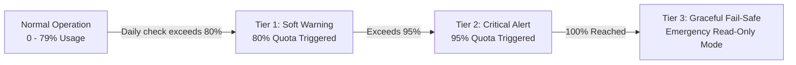

# Infrastructure Costs & Free-Tier Quota Governance — Lunhaw

> **Document ID:** D-M0-05  
> **Status:** Active / Enforced  
> **Target Monthly Operating Cost:** **$0.00 / month**  
> **Last Audited:** 2026-11-03  
> **Compliance & Invariant Links:** `INV-001` (Data Honesty), `INV-003` (Platform-Neutral API), `T-003` (Zero-Retention Location Privacy), RA 10173 (Philippine DPA).

---

## 1. Executive Summary & Cost Philosophy

Lunhaw is engineered specifically for Metro Manila's civic public spaces, shaded walking corridors, and student haven discovery under a **perpetual $0.00/month infrastructure budget**. The entire architecture leverages enterprise-grade generous free tiers offered by edge cloud providers and open civic infrastructure:

- **Frontend & Client Delivery:** Cloudflare Pages (Jamstack static hosting with global CDN)
- **API Gateway & Routing Edge:** Cloudflare Workers (Edge compute running v8 isolates in Manila `MNL`)
- **Database & Spatial Engine:** Supabase Managed PostgreSQL with PostGIS (`ap-southeast-1` Singapore)
- **Object & Static Tile Cache:** Cloudflare R2 (S3-compatible zero-egress object storage)
- **Base Map Vector Tiles:** OpenFreeMap (Open-source, unmetered, community-sponsored vector tile CDN)
- **CI/CD Automation:** GitHub Actions (Automated linting, typechecking, testing, and migration verification)

To guarantee that Lunhaw **never accrues accidental credit card charges**, all accounts operate strictly on free-tier plans without automatic billing upgrades or paid overage attachments. If hard limits are approached, the system triggers graceful degradation modes (caching layers, static GeoJSON fallbacks, and local client search) rather than failing catastrophically or incurring financial debt.

---

## 2. Service Free-Tier Limits & Capacity Matrix

| Provider & Service | Resource / Metric | Free-Tier Allocation | 80% Soft Warning Threshold | 95% Critical Alert Threshold | Hard Ceiling Impact |
|---|---|---|---|---|---|
| **Supabase PostgreSQL** | Database Disk Storage | **500 MB** | 400 MB | 475 MB | Writes rejected; database transitions to read-only mode. |
| **Supabase PostgreSQL** | Monthly Active Users (MAU) | **50,000 MAU** | 40,000 MAU | 47,500 MAU | New auth signups blocked. |
| **Supabase Storage** | File / Media Storage | **1.0 GB** | 800 MB | 950 MB | Asset uploads rejected (`413 Payload Too Large`). |
| **Supabase Bandwidth** | Data Egress / Month | **2.0 GB** | 1.6 GB | 1.9 GB | Bandwidth throttled or egress blocked until cycle reset. |
| **Supabase Compute** | Project Inactivity | **7 days** without queries | Inactivity ping at Day 4 | Inactivity ping at Day 6 | Database pauses; 10–15s cold start latency on wake. |
| **Supabase Functions** | Edge Function Invocations | **500,000 / month** | 400,000 / mo | 475,000 / mo | Requests rejected with HTTP 429. |
| **Cloudflare Workers** | Inbound Requests | **100,000 / day** (3M / mo) | 80,000 / day | 95,000 / day | HTTP 1015 / 429 error returned to excess clients. |
| **Cloudflare Workers** | CPU Time per Request | **10 ms CPU** | 7 ms CPU (avg) | 9 ms CPU (avg) | Worker execution terminated (`Error 1102`). |
| **Cloudflare Workers** | Memory Allocation | **128 MB** | 100 MB | 120 MB | V8 isolate memory limit exception. |
| **Cloudflare Pages** | Bandwidth Egress | **Unlimited** | N/A | N/A | Unmetered global delivery via Cloudflare anycast. |
| **Cloudflare Pages** | Production Builds | **500 builds / month** | 400 builds / mo | 475 builds / mo | Subsequent automated git-triggered deployments fail. |
| **Cloudflare Pages** | Deployment Asset Bounds | **20,000 files / deploy**; max 25 MB/file | 16,000 files | 19,000 files | Deployment validation fails. |
| **Cloudflare R2** | Storage Volume | **10 GB** | 8.0 GB | 9.5 GB | Upload operations rejected. |
| **Cloudflare R2** | Class A Operations (Write/List) | **1,000,000 / month** | 800,000 / mo | 950,000 / mo | PutObject / ListBucket operations blocked. |
| **Cloudflare R2** | Class B Operations (Read) | **10,000,000 / month** | 8,000,000 / mo | 9,500,000 / mo | GetObject operations throttled. |
| **Cloudflare R2** | Egress Bandwidth | **$0 / Unlimited** | N/A | N/A | Zero egress fees; guaranteed by Cloudflare R2 terms. |
| **OpenFreeMap CDN** | Vector Map Tiles | **Free / Unmetered** | N/A | Respectful rate limits | Fallback to self-hosted GeoJSON or raster OSM tiles. |
| **GitHub Actions** | Workflow Run Minutes | **Unlimited** (Public Repo) / 2,000 min (Private) | 1,600 min | 1,900 min | CI workflow queues suspended until next billing month. |

---

## 3. Explicit Quota Triggers & Escalation Tiers

To prevent outages, the following three-tier escalation protocol is strictly enforced:



### 3.1. Tier 1: Soft Warning Trigger (80% Utilization)
- **Notification:** GitHub Issue automatically opened with label `ops:quota-warning` and alert webhook posted to administrative maintenance channel.
- **Required Engineering Actions:**
  1. Inspect `pg_stat_user_tables` to identify database table bloating.
  2. Execute table vacuuming and index re-indexing on PostgreSQL.
  3. Increase Cloudflare Cache-Control TTLs on edge workers to reduce Supabase egress.
  4. Purge stale temporary route calculation traces and expired audit logs.

### 3.2. Tier 2: Critical Alert Trigger (95% Utilization)
- **Notification:** Immediate high-priority notification to core maintainers.
- **Enforced Mitigations:**
  1. **Storage Cap Mitigation:** Execute immediate archiving of historical audit logs older than 90 days to compressed R2 cold storage.
  2. **Worker Request Conservation:** Activate aggressive stale-while-revalidate caching on Cloudflare Workers for all `/api/v1/places` and `/api/v1/locations` endpoints (TTL raised to 24 hours).
  3. **Commute Computation Throttle:** Disable multi-modal routing iterations beyond 2 transfers to cap worker CPU time under 5 ms.

### 3.3. Tier 3: Emergency Fail-Safe (100% / Outage Risk)
- **Fail-Safe Mechanism:** Rather than taking the service offline:
  1. **Static Snapshot Cutover:** The web client cuts over to the bundled `public/data/places-metro-manila.geojson` snapshot, serving 100% of directory and search traffic via static assets on Cloudflare Pages.
  2. **Client-Side Geolocation Filtering:** Spatial distance calculations execute client-side via Turf.js / Web Workers rather than PostGIS queries.
  3. **Read-Only Lock:** Database mutations (new reviews, moderation flags) return `HTTP 503 Service Unavailable` with RFC 7807 problem details explaining scheduled maintenance.

---

## 4. Quota Mitigation & Conservation Playbooks

### 4.1. Supabase Database Storage Management (500 MB Budget)

Metro Manila contains ~1,700 barangays across 17 LGUs, with an estimated initial dataset of ~1,500 civic green spaces, parks, and public libraries. A lean PostgreSQL schema requires approximately:
- `places` row: ~500 bytes (with GeoJSON point and metadata) &times; 1,500 = **0.75 MB**
- `libraries` row: ~300 bytes &times; 500 = **0.15 MB**
- `transit_nodes` row: ~250 bytes &times; 4,000 = **1.00 MB**
- `shade_canopy_metrics` row: ~200 bytes &times; 10,000 = **2.00 MB**
- PostGIS spatial indexes (GiST): **~5.00 MB**
- Core data total: **< 15 MB** (leaving > 480 MB buffer for growth, audit trails, and indexes).

#### Optimization Protocols:
1. **Geometry Precision Truncation:**
   All coordinate pairs are stored at 6 decimal places (~0.11 m resolution, exceeding civic navigation requirements):
   ```sql
   UPDATE places SET geom = ST_QuantizeCoordinates(geom, 6);
   ```
2. **Periodic Vacuuming & Index Maintenance:**
   A monthly maintenance job executes:
   ```sql
   VACUUM ANALYZE places;
   VACUUM ANALYZE transit_nodes;
   VACUUM ANALYZE verification_meta;
   REINDEX INDEX idx_places_geom;
   REINDEX INDEX idx_transit_nodes_geom;
   ```
3. **Database Keep-Alive (Preventing 7-Day Inactivity Pause):**
   Supabase free-tier projects pause after 7 consecutive days of inactivity. Lunhaw prevents this through an automated GitHub Actions scheduled cron job (`.github/workflows/keepalive.yml`) that issues a lightweight read query (`SELECT 1;` or `GET /api/v1/health`) every Tuesday and Saturday at 03:00 UTC.

### 4.2. Cloudflare Workers Request & CPU Conservation (100,000 req/day; 10 ms CPU)

1. **Edge Caching via Cache API:**
   All read requests for static municipal data (`/api/v1/locations/areas`, `/api/v1/places/{id}`) utilize the Cloudflare Edge Cache:
   ```typescript
   // Standard edge caching rule
   response.headers.set(
     "Cache-Control",
     "public, max-age=3600, s-maxage=86400, stale-while-revalidate=604800"
   );
   ```
2. **Quantized Spatial Hashing for Commute Routes:**
   To prevent duplicate routing engine invocations, route requests round `(origin_lat, origin_lng)` and `(dest_lat, dest_lng)` to 4 decimal places (~11 meters) to create a deterministic cache key. Identical transit requests from commuters are served directly from Cloudflare KV/Cache without touching the origin.
3. **Zero-Retention Location Privacy (`T-003` Compliance):**
   In strict compliance with Philippine RA 10173 and threat model `T-003`, user geolocation coordinates are stripped from logging pipelines before edge responses terminate.

### 4.3. Cloudflare Pages & Build Optimization (500 builds/month)

1. **Path-Filtered CI Triggers:**
   GitHub Actions and Cloudflare Pages webhook builds only trigger when frontend-relevant paths change (`apps/web/**`, `packages/ui/**`, `packages/config/**`). Pure documentation or SQL migration commits do not consume build quotas.
2. **Asset Compression & Chunk Splitting:**
   Next.js static export generates pre-gzipped and Brotli-compressed HTML/JS/CSS assets. Base vector styles and fonts (`MedievalSharp`, `Kufam`) are preloaded and immutable-cached (`max-age=31536000, immutable`).

### 4.4. Cloudflare R2 Asset Delivery (10 GB; Zero Egress)

1. High-resolution facility photography is banned from direct database storage (`BYTEA`).
2. Images submitted during civic verification are compressed to WebP/AVIF (< 200 KB per photo), uploaded to Cloudflare R2, and served via custom domain edge caching.
3. Egress fees are strictly $0.00 in accordance with Cloudflare's core R2 pricing model.

---

## 5. Automated Quota Monitoring Pipeline

A dedicated automated health check script monitors infrastructure headroom:

```yaml
# Conceptual cron specification for metrics observation
name: Quota Headroom Monitor
on:
  schedule:
    - cron: '0 0 * * *' # Daily at midnight UTC
```

The monitor checks:
1. **Supabase Disk Usage:** Queries `SELECT pg_database_size(current_database());` — alerts if `> 400 MB`.
2. **Cloudflare Worker Analytics:** Queries Cloudflare GraphQL API for 24-hour request count — alerts if `> 80,000 req`.
3. **Cloudflare Pages Build Count:** Queries Cloudflare API for current month build count — alerts if `> 400 builds`.

---

## 6. Upgrade Triggers & Financial Sponsorship Path

Under no circumstances will personal funds or maintainer credit cards be automatically charged for cloud scaling. If Lunhaw's civic adoption exceeds free-tier limits:

1. **Civic & Institutional Sponsorship:** Apply for non-profit / open-source hosting grants (e.g. Supabase Open Source Sponsorship, Cloudflare Project Galileo, AWS Open Data Sponsorship).
2. **LGU Partnership:** Partner with Metro Manila LGUs (e.g. Quezon City, Manila, Pasig) or the National Library of the Philippines (NLP) to sponsor dedicated infrastructure.
3. **Community-Hosted Micro-Mirrors:** If tile or routing traffic saturates edge limits, route requests to federated open-source mirrors running on community volunteer hardware.
