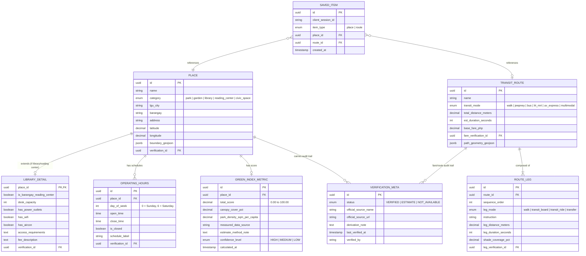

# Data Model / Schema — Lunhaw

> **Purpose:** Database entities, relational schemas, constraints, field definitions, and privacy classifications for the platform-neutral backend.
> Traces back to: [prd.md](prd.md), [system-design.md](system-design.md). Traces forward to: [api-spec.md](api-spec.md), [methods.md](methods.md).

## Entities & relationships (ERD)

## Schema / field definitions

### 1. `places`
| Field | Type | Null? | Default | Description |
|---|---|---|---|---|
| `id` | UUID | No | `gen_random_uuid()` | Primary Key |
| `name` | VARCHAR(255) | No | — | Official name of the civic space |
| `category` | VARCHAR(50) | No | — | `park`, `garden`, `library`, `reading_center`, `civic_space` |
| `description` | TEXT | Yes | NULL | Public description and historical/community context |
| `lgu_city` | VARCHAR(100) | No | — | Metro Manila city/municipality (e.g. `Manila`, `Quezon City`) |
| `barangay` | VARCHAR(100) | No | — | Barangay jurisdiction name |
| `address` | TEXT | Yes | NULL | Physical street address |
| `coordinates` | GEOGRAPHY(Point, 4326) | No | — | Latitude and Longitude coordinates |
| `boundary_geojson` | JSONB | Yes | NULL | Spatial boundary polygon (for parks/gardens) |
| `verification_id` | UUID | No | — | FK referencing `verification_meta.id` (`INV-001`) |
| `created_at` | TIMESTAMPTZ | No | `NOW()` | Record creation timestamp |
| `updated_at` | TIMESTAMPTZ | No | `NOW()` | Record modification timestamp |

### 2. `library_details`
| Field | Type | Null? | Default | Description |
|---|---|---|---|---|
| `place_id` | UUID | No | — | Primary Key / FK referencing `places.id` |
| `is_barangay_reading_center` | BOOLEAN | No | `FALSE` | Flag differentiating barangay centers from city central libraries |
| `desk_capacity` | INTEGER | Yes | NULL | Approximate number of study desks available |
| `has_power_outlets` | BOOLEAN | Yes | NULL | Power charging availability for laptops/phones |
| `has_wifi` | BOOLEAN | Yes | NULL | Public Wi-Fi access |
| `has_aircon` | BOOLEAN | Yes | NULL | Air-conditioning or climate control availability |
| `access_requirements` | TEXT | Yes | NULL | Requirements for entry (e.g. Valid Student ID, Barangay Clearance) |
| `fee_description` | VARCHAR(100) | No | `'Free'` | Cost description (defaulting to Free for public facilities) |
| `verification_id` | UUID | No | — | FK referencing `verification_meta.id` |

### 3. `operating_hours`
| Field | Type | Null? | Default | Description |
|---|---|---|---|---|
| `id` | UUID | No | `gen_random_uuid()` | Primary Key |
| `place_id` | UUID | No | — | FK referencing `places.id` |
| `day_of_week` | SMALLINT | No | — | `0` (Sun) to `6` (Sat) |
| `open_time` | TIME | Yes | NULL | Official opening time |
| `close_time` | TIME | Yes | NULL | Official closing time |
| `is_closed` | BOOLEAN | No | `FALSE` | Closed all day flag |
| `schedule_label` | VARCHAR(100) | Yes | NULL | Optional label (e.g. "Lunch break 12-1pm") |
| `verification_id` | UUID | No | — | FK referencing `verification_meta.id` (`INV-001`) |

### 4. `green_index_metrics`
| Field | Type | Null? | Default | Description |
|---|---|---|---|---|
| `id` | UUID | No | `gen_random_uuid()` | Primary Key |
| `place_id` | UUID | No | — | FK referencing `places.id` |
| `total_score` | DECIMAL(5,2) | No | — | Computed Green Index score (`0.00` to `100.00`) |
| `canopy_cover_pct` | DECIMAL(5,2) | No | — | Measured tree canopy cover percentage |
| `park_density_sqm_per_capita` | DECIMAL(8,2) | Yes | NULL | Neighborhood green space area per capita |
| `measured_data_source` | VARCHAR(255) | No | — | Citation of dataset (e.g. Sentinel-2 / LGU GIS) |
| `estimate_method_note` | TEXT | Yes | NULL | Glass-box calculation note if estimated (`EQ-001`) |
| `confidence_level` | VARCHAR(20) | No | `'MEDIUM'` | `HIGH`, `MEDIUM`, `LOW` (per methods rubric) |
| `calculated_at` | TIMESTAMPTZ | No | `NOW()` | Calculation timestamp |

### 5. `verification_meta`
| Field | Type | Null? | Default | Description |
|---|---|---|---|---|
| `id` | UUID | No | `gen_random_uuid()` | Primary Key |
| `status` | VARCHAR(20) | No | — | `VERIFIED`, `ESTIMATE`, `NOT_AVAILABLE` (`INV-001`) |
| `official_source_name` | VARCHAR(255) | Yes | NULL | Official institution / LGU department name |
| `official_source_url` | VARCHAR(500) | Yes | NULL | Direct link to public documentation or memo |
| `derivation_note` | TEXT | Yes | NULL | Mandatory methodology explanation if `status = 'ESTIMATE'` |
| `last_verified_at` | TIMESTAMPTZ | Yes | NULL | Timestamp of last manual or automated audit |
| `verified_by` | VARCHAR(100) | Yes | NULL | Auditor identifier or ingestion script name |

## Constraints & indexes
- `idx_places_coordinates`: Spatial GiST index on `places.coordinates` for ultra-fast radius searches (`ST_DWithin`).
- `idx_places_lgu_barangay`: Compound B-tree index on `(lgu_city, barangay)` for manual area selection queries.
- `idx_operating_hours_place_day`: Compound index on `(place_id, day_of_week)`.
- `chk_verification_derivation`: `CHECK (status != 'ESTIMATE' OR derivation_note IS NOT NULL)` ensures an estimated value cannot exist without an explanatory note.
- `chk_green_score_bounds`: `CHECK (total_score >= 0.0 AND total_score <= 100.0)`.

## Retention & privacy classification

| Entity / Field | Classification | Retention | Deletion & Privacy Policy |
|---|---|---|---|
| `places.*` | Public | Indefinite | Public civic information; no individual PII. |
| `library_details.*` | Public | Indefinite | Civic facilities. |
| `saved_items.client_session_id` | Pseudonymous PII | 90 days of inactivity | Local client storage first; server sessions purged on request or 90 days idle. |
| User Geolocation Coordinates | Ephemeral / Sensitive | 0 seconds (Never stored) | Geolocation queries process entirely in memory; GPS coordinates are never written to disk or logs (`INV-001`). |

## Migration notes
- Initial migration establishes PostGIS extension: `CREATE EXTENSION IF NOT EXISTS postgis;`.
- Seed data scripts must validate that all initial records link to a valid `verification_meta` entry.
