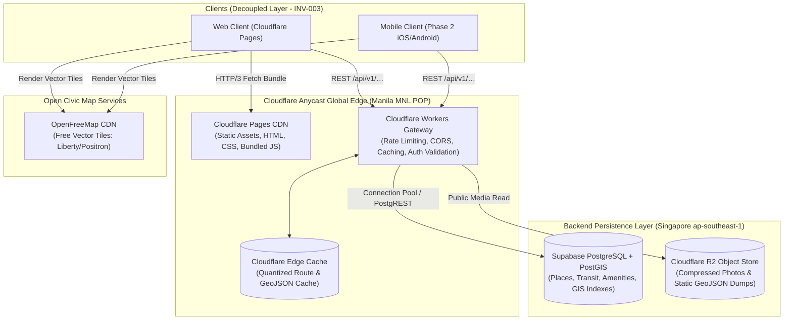

# ADR-001: Cloud Architecture & $0/Month Infrastructure Stack for Metro Manila Civic Platform

- **Document ID:** ADR-001 (D-M0-06)
- **Date:** 2026-11-03
- **Status:** Accepted
- **Driver:** Lead Architect / Infrastructure & Governance
- **Traces Back To:** `docs/prd.md`, `docs/system-design.md`, `docs/COSTS.md`
- **Enforces Invariants:** `INV-001` (Data Honesty), `INV-002` (Mandatory Advisory Disclaimer), `INV-003` (Platform-Neutral API Contract), `T-003` (Zero-Retention Location Privacy), Philippine Data Privacy Act of 2012 (RA 10173).

---

## 1. Context & Problem Statement

Lunhaw is a public civic discovery platform engineered for students, commuters, and urban residents across Metro Manila's 17 Local Government Units (LGUs). The application solves two acute urban challenges:
1. Identifying free, verified, quiet public study spaces and reading centers equipped with seating, desks, and electrical outlets.
2. Generating shaded pedestrian and multi-modal transit corridors to mitigate extreme tropical heat index exposure (> 42°C) during daily urban commutes.

The architecture must satisfy the following critical forces and real-world constraints:
- **Strict $0.00/Month Operational Budget:** The project has zero dedicated ongoing institutional funding at inception. Maintainers must never face credit card bill shock, stealth overage fees, or forced tier upgrades.
- **Metro Manila Low Latency:** Mobile users access the platform across high-latency, fluctuating 4G/5G mobile cellular networks (Globe, Smart, DITO) and home fiber (PLDT, Converge). Static assets and frequently queried civic directory endpoints must resolve with ultra-low Time-To-First-Byte (TTFB < 50ms within Metro Manila).
- **Relational GIS & Spatial Querying:** High-performance spatial indexing (bounding box queries, k-nearest neighbors `ST_DWithin`, geometry intersections) is required for thousands of transit nodes, parks, and shaded pathways.
- **Platform-Neutral Decoupling (`INV-003`):** Web (Phase 1) and native mobile apps (Phase 2 iOS/Android) must consume an identical, versioned REST/JSON API gateway with zero architectural lock-in to web-only full-stack frameworks.
- **Zero-Retention Location Privacy (`T-003` & RA 10173):** Exact user GPS coordinates must never be stored on disk, logged in access registries, or transmitted to third-party ad networks.

---

## 2. Options Considered

### Option 1: Cloudflare Pages + Workers + Supabase (PostGIS) + OpenFreeMap + Cloudflare R2 (Chosen Canonical Stack)
- **Frontend Delivery:** Cloudflare Pages hosting Next.js static export / Jamstack distribution.
- **API Gateway & Routing Edge:** Cloudflare Workers (V8 isolates running at Cloudflare's Manila `MNL` edge location).
- **Spatial Relational Database:** Supabase managed PostgreSQL with PostGIS in Singapore (`ap-southeast-1`).
- **Base Map Vector Tiles:** OpenFreeMap (unmetered, zero-cost, open-source vector tile CDN running MapLibre GL).
- **Static Assets & Media:** Cloudflare R2 (10 GB storage with zero egress fees).
- **Pros:**
  - **True $0.00/month baseline:** All components operate within perpetual free tiers with no credit card billing auto-upgrades.
  - **Manila Edge POP (`MNL`):** Cloudflare operates anycast nodes directly peering with major Philippine telcos (PLDT, Globe, DITO), delivering single-digit millisecond latency for cached static assets and edge responses.
  - **Singapore Database Low RTT:** Supabase `ap-southeast-1` provides ~25–35ms round-trip ping to Metro Manila, optimal for dynamic queries.
  - **Enterprise PostGIS:** Fully functional PostgreSQL database with native PostGIS spatial functions (`ST_Point`, `ST_DWithin`, `ST_DistanceSphere`).
  - **No Mapbox API limits:** OpenFreeMap avoids the punitive commercial billing cliff of Mapbox or Google Maps Platform.
  - **Platform-Neutral (`INV-003`):** Cloudflare Workers serves standard REST/JSON endpoints accessible by both Web and future React Native / Flutter mobile clients.
- **Cons & Constraints:**
  - Supabase free tier caps storage at 500 MB (requires data pruning and coordinate quantization).
  - Supabase pauses inactive projects after 7 days (mitigated via automated scheduled GitHub Actions keepalive ping).
  - Cloudflare Workers enforce a 10ms CPU time limit per request on the free plan (requires spatial route caching and efficient algorithms).
- **Net Cost:** **$0.00 / month**.

---

### Option 2: Single Dedicated Virtual Private Server (VPS) on Hetzner or DigitalOcean
- **Architecture:** Single Ubuntu Linux VPS running Docker Compose with Node.js/Go backend, local PostgreSQL/PostGIS container, and TileServer-GL.
- **Pros:**
  - Full root access, no provider-imposed 10ms CPU limits or 500 MB database storage caps.
  - Simple local networking between backend container and database container.
- **Cons:**
  - **Violates $0/Month Mandate:** A Hetzner Cloud CPX11 or DigitalOcean Droplet costs $4.00 to $12.00/month continuously.
  - **Single Point of Failure (SPOF):** If the VPS experiences kernel panic, storage exhaustion, or data center downtime, the entire platform goes offline.
  - **Maintenance Burden:** Demands regular OS kernel updates, security patching, SSL certificate renewal, fail2ban monitoring, and manual offsite database backup pipelines.
  - **High Latency:** Low-cost European/US VPS nodes incur 180–250ms round-trip latency to Manila users; Singapore VPS nodes are more expensive and consume paid egress bandwidth.
- **Net Cost:** **$4.00 – $15.00 / month** (Unacceptable under zero-budget mandate).

---

### Option 3: AWS Free Tier (EC2 t4g.micro + RDS PostgreSQL db.t3.micro + CloudFront + S3)
- **Architecture:** Standard AWS 3-tier architecture deployed in `ap-southeast-1` (Singapore).
- **Pros:**
  - Industry-standard infrastructure and deep ecosystem integration.
- **Cons:**
  - **12-Month Expiration Trap:** The AWS Free Tier expires after 12 months, converting into recurring commercial charges ($20–$40/month minimum for RDS and EC2).
  - **Severe Out-of-Memory (OOM) Risks:** RDS `db.t3.micro` provides only 1 GB RAM, frequently crashing under concurrent PostGIS spatial index scans or complex geometry joins.
  - **Hidden Egress & NAT Gateway Traps:** AWS charges for inter-AZ data transfer, NAT Gateways ($32/month base), and egress overages.
  - **Complex IAM Overhead:** Substantial cognitive and deployment configuration complexity compared to serverless edge platforms.
- **Net Cost:** **$0.00 initially &rarr; $35.00+/month after 12 months** (Violates perpetual zero-budget mandate).

---

### Option 4: Vercel + Neon Serverless Postgres + Mapbox GL
- **Architecture:** Vercel frontend and serverless functions, Neon serverless branching database, Mapbox GL JS map rendering.
- **Pros:**
  - Rapid zero-config deployment experience for Next.js applications.
  - Neon branching workflows for database development.
- **Cons:**
  - **Mapbox Billing Cliff:** Mapbox charges $5.00 per 1,000 loads once traffic exceeds 50,000 monthly map loads. A single viral social media post would trigger immediate billing charges or map account suspension.
  - **Vercel Hobby Plan Restrictions:** Vercel Hobby terms explicitly forbid commercial or civic institutional organizational growth; strict monthly function execution caps.
  - **Neon Cold Starts & Compute Hours Limit:** Neon's free tier limits active compute hours (100 hours/month pool), forcing severe database throttling or connection termination when idle quotas expire.
  - **Web Framework Coupling:** Vercel Serverless Functions tend to tightly couple backend routes to Next.js API routes, complicating clean reuse for native mobile clients (`INV-003`).
- **Net Cost:** **$0.00 – $100.00+/month** (High risk of sudden billing spikes).

---

## 3. Decision

We **accept Option 1: Cloudflare Pages + Cloudflare Workers + Supabase (PostGIS) + OpenFreeMap + Cloudflare R2** as the canonical production architecture for Lunhaw.

### Architecture Topology Diagram

---

## 4. Consequences & Trade-Off Analysis

### Positive Consequences (What Becomes Easier)
1. **Guaranteed $0.00 Operating Cost:** Zero maintainer credit card liability. No accidental cost overages are possible because paid billing triggers are disabled at the provider account level.
2. **Sub-30ms Latency for Metro Manila Users:** Cloudflare's Manila Anycast point of presence (`MNL`) delivers edge-cached place queries, municipal boundaries, and UI bundles directly within the Philippine national peering exchange.
3. **Robust Spatial Queries:** Full PostGIS support enables genuine nearest-neighbor indexing (`<->`), spatial radius filtering, and walkability buffering without relying on inferior NoSQL geohash approximations.
4. **Architectural Decoupling (`INV-003`):** The Cloudflare Workers REST API operates as a platform-neutral interface. When Phase 2 mobile applications launch, they will interface with the identical OpenAPI-specified endpoints without modifying backend code.
5. **Absolute Privacy Compliance (`T-003`):** Edge workers sanitize and strip coordinate parameters before logs are processed, ensuring end-to-end compliance with the Philippine Data Privacy Act of 2012 (RA 10173).

### Negative Consequences & Mitigations (What We Now Owe)
1. **500 MB Database Storage Cap:**
   - *Mitigation:* As specified in `docs/COSTS.md`, coordinates are quantized to 6 decimal places, historical audit logs older than 90 days are pruned, and raw raster imagery is strictly forbidden from the relational database.
2. **7-Day Supabase Inactivity Pause:**
   - *Mitigation:* An automated GitHub Actions scheduled workflow (`keepalive.yml`) queries the health endpoint bi-weekly to prevent project sleep.
3. **10ms Cloudflare Worker CPU Limit:**
   - *Mitigation:* Heavy transit route calculations are capped to pre-indexed transit networks; route candidates use quantized coordinate caching at the edge.
4. **Free Vector Tile Availability:**
   - *Mitigation:* OpenFreeMap provides unmetered public vector tiles. Should OpenFreeMap encounter service disruptions, the client gracefully falls back to local GeoJSON boundary rendering or OpenStreetMap standard raster tiles.

---

## 5. Review Triggers & Invalidation Conditions

This decision record must be revisited and formally reviewed if any of the following triggers occur:
1. **Database Storage Exceeds 80% (400 MB):** Requires review of database partitioning, archiving, or seeking civic sponsorship.
2. **Daily Active Inbound Requests Exceed 80,000 req/day:** Requires evaluation of Cloudflare Paid Workers ($5/mo) or applying for Cloudflare Project Galileo civic sponsorship.
3. **Phase 2 Mobile Application Launch:** Evaluates whether edge push notification infrastructure or WebSockets require additional serverless pub/sub brokers.
