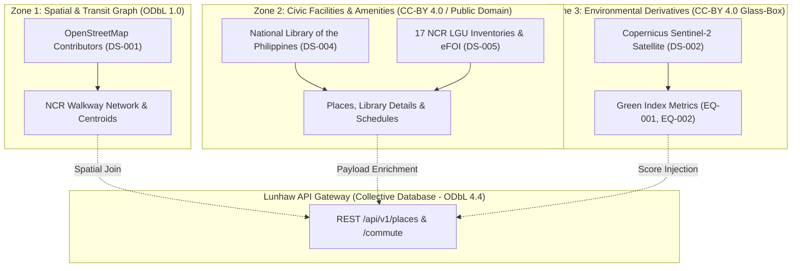
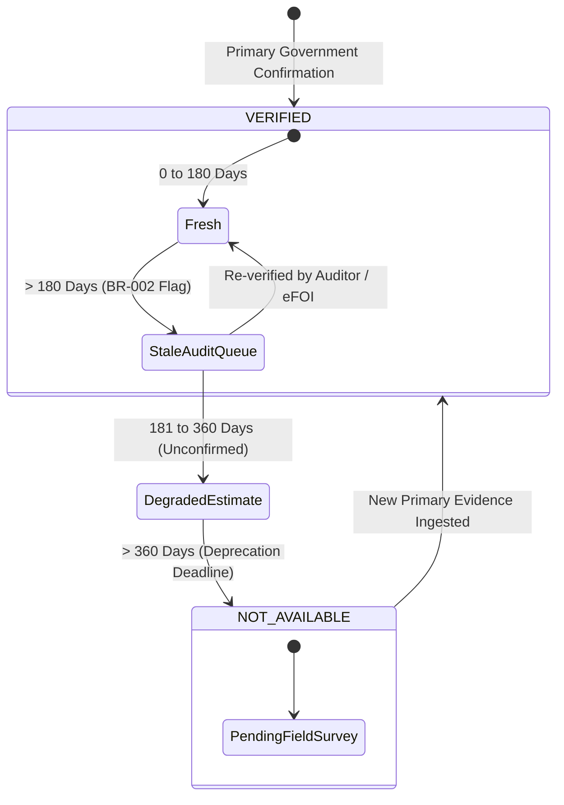

# ADR-002: LGU Civic Data Licensing, Open Data Compatibility & Multi-Tier Update Cadence for Metro Manila

- **Document ID:** ADR-002 (B-M1-04)
- **Date:** 2026-11-03
- **Status:** Accepted
- **Driver:** Lead Data Architect & Civic Governance Liaison
- **Traces Back To:** `docs/prd.md` (§12 PRD Open Questions), `docs/data-guardrails.md`, `docs/methods.md` (`DS-001`, `DS-004`, `DS-005`), `docs/data-model.md`, `docs/ISSUE_CODES.md` (`B-M1-04`)
- **Enforces Invariants:** `INV-001` (Data Honesty), `INV-002` (Mandatory Facility Advisory Disclaimer), `BR-001` (Tri-State Integrity Tags), `BR-002` (180-Day Verification Freshness Window), Philippine Data Privacy Act of 2012 (RA 10173), Executive Order No. 2, s. 2016 (Freedom of Information).

---

## 1. Context & Problem Statement

Lunhaw is a public civic discovery platform providing Metro Manila students, commuters, and urban residents with verified locations of free study havens, public libraries, and barangay reading centers, paired with shaded green mobility corridors.

Unlike centralized national services, civic facility management in the National Capital Region (NCR) is distributed across **17 autonomous Local Government Units (16 highly urbanized cities and 1 municipality)** and further decentralized into **1,710 individual barangays**. This geopolitical fragmentation creates three formidable operational hurdles:

1. **Severe Digital Maturity & Data Disparity:** 
   LGUs like Quezon City and Pasig operate modern GIS teams and digital citizen portals, while other LGUs track reading centers via static PDF directories, annual printed budget gazettes, or informal barangay hall bulletin boards.
2. **Student Safety & Public Trust (`INV-001`, `INV-002`):**
   Students and exam-reviewees in Metro Manila face severe financial friction (commercial cafés charge ₱150–₱300 per visit). If Lunhaw directs a student to a barangay reading center that closed down, changed its hours, or was converted into an emergency relief outpost, civic trust is destroyed.
3. **Open Data Licensing Compatibility & "Share-Alike" Contamination Risk:**
   Lunhaw integrates pedestrian routing networks sourced from OpenStreetMap (`DS-001`, licensed under **ODbL 1.0**) with municipal library listings (`DS-004`, `DS-005`, published under **Creative Commons CC-BY 4.0**, **Philippine Government Open Data**, or **Public Domain**). Maintainers must guarantee that consuming ODbL pedestrian segments does not trigger viral copyleft contamination over municipal civic directories, and conversely, that LGU terms do not restrict free public redistribution.

We must formally decide on our civic data licensing intake agreements, multi-license architecture, Freedom of Information (eFOI) standard operating procedure, and verification update cadence across all 17 NCR LGUs.

---

## 2. Options Considered

### Option 1: Negotiate Bilateral Memoranda of Agreement (MOA) with All 17 LGUs Prior to Launch
- **Strategy:** Withhold directory listings until a formal legal partnership and digital data-sharing MOA is signed with each City Council (*Sangguniang Panlungsod*) and Mayor's office.
- **Pros:**
  - Official municipal stamp of approval and dedicated LGU IT pipeline.
- **Cons:**
  - **Fatal Timeline Paralysis:** Passing 17 individual municipal council resolutions in Metro Manila takes 12 to 24 months minimum.
  - **Political Vulnerability:** Triennial local elections frequently dissolve informal bureaucratic partnerships and require re-negotiation.
  - **Budget Barrier:** Contradicts the project's $0/month operational baseline.

---

### Option 2: Unilateral Web Scraping & Unverified Crowdsourcing Without Formal Licensing Framework
- **Strategy:** Scrape municipal Facebook pages, Google Maps listings, and student forums, using probabilistic LLMs to predict schedules.
- **Pros:**
  - Rapid zero-cost directory bootstrapping.
- **Cons:**
  - **Strict Invariant Violation (`INV-001`):** Scraping uncurated channels frequently outputs outdated COVID-19 era schedules or fictional hours, directly violating the glass-box zero-hallucination mandate.
  - **Terms of Service & Copyright Hazards:** Uncurated scraping exposes the project to IP infringement and cease-and-desist notices.
  - **Zero Accountability:** Inability to cite primary official government URLs (`NV-002`).

---

### Option 3: Tiered Intake Framework: ODbL/CC-BY Collective Database Doctrine + Standardized eFOI Ingestion + 3-Tier LGU Cadence (Chosen Canonical Policy)
- **Strategy:** 
  1. Leverage the **"Collective Database"** doctrine under ODbL Section 4.4 to maintain strict legal separation between spatial routing data and civic place metadata.
  2. Standardize data intake under existing Philippine statutory authority: **Executive Order No. 2, s. 2016 (Freedom of Information)** via the national eFOI portal (`foi.gov.ph`).
  3. Stratify the 17 NCR LGUs into three operational tiers based on digital readiness, establishing 90-day, 180-day, and 360-day verification cadences backed by business rule `BR-002`.
- **Pros:**
  - **Legally Sound:** Precludes ODbL copyleft contamination while strictly adhering to open government mandates.
  - **Immediate Operational Viability:** Does not require waiting for legislative council approvals; utilizes established eFOI procedures.
  - **Enforces Data Honesty (`INV-001`, `BR-001`, `BR-002`):** Every record carries an explicit provenance URL, auditor signature, and freshness expiration countdown.
- **Cons:**
  - Requires continuous automated scraping pipelines for Tier A LGUs and semi-annual FOI filings for Tier B/C LGUs.
  - Stale records (> 180 days) must be actively downgraded if unconfirmed, requiring disciplined data curation.

---

## 3. Decision

We **accept Option 3: Tiered Intake Framework, Collective Database Licensing, Standardized eFOI Protocols, and 3-Tier LGU Cadence** as the canonical data governance policy for Lunhaw.

### 3.1 Open Data Licensing & Compatibility Matrix

To eliminate licensing conflict while guaranteeing unmetered public access, Lunhaw partitions its data pipeline into three distinct licensing zones:



| Dataset Category | Dataset ID | Upstream Source | Primary License | Downstream Redistribution Policy |
|---|---|---|---|---|
| **Road & Walkway Graphs** | `DS-001` | OpenStreetMap Contributors | **ODbL 1.0** (Open Database License) | **Share-Alike:** Any structural modification to the walkway topology is published upstream to OSM or exported as open GeoJSON (`data/ncr-walkways-sample.geojson`). |
| **Satellite Imagery** | `DS-002` | European Space Agency (ESA) Copernicus | **CC BY-SA 3.0 IGO** / Open Access | **Attribution:** Citations embedded in `green_index_metrics.measured_data_source`. |
| **PUV Fare Matrices** | `DS-003` | LTFRB Memorandum Circulars | **Philippine Public Domain** (RA 8293 §176) | No copyright on official Philippine government regulatory edicts. |
| **National Libraries Directory** | `DS-004` | National Library of the Philippines (NLP) | **Government Open Data / Public Domain** | Free civic redistribution; cite official NLP catalog URL. |
| **Municipal Reading Centers** | `DS-005` | 17 NCR Local Government Units | **CC-BY 4.0 / eFOI Open Disclosure** | Free public redistribution; cite municipal source portal. |

#### Collective Database Declaration (ODbL Section 4.4)
Under Section 4.4 of the Open Database License (ODbL), a *Collective Database* consists of independent databases assembled into a collective whole without forming a single adapted database. 

Lunhaw explicitly declares that:
1. Spatial pedestrian networks (`DS-001`) and civic facility directories (`DS-004`, `DS-005`) remain **independent relational database tables** within PostgreSQL/PostGIS.
2. The REST API performs runtime spatial joins (`ST_DWithin`) between separate entities. The civic metadata (amenity flags, desk capacities, operating hours) does **not** constitute a "Derivative Database" of OpenStreetMap and is **not** subject to the ODbL viral share-alike provision.
3. Civic facility metadata is published under **Creative Commons Attribution 4.0 International (CC-BY 4.0)**, allowing students, researchers, and developers to reuse Lunhaw data freely with attribution.

---

### 3.2 17 NCR Local Government Unit (LGU) Stratification & Update Cadence

To balance data freshness against maintainer operational capacity, all 17 Metro Manila LGUs are categorized into three operational tiers:

| Tier | Update Cadence | Harvest Mechanism | LGUs Assigned | Primary Sources & Fallback Policy |
|---|---|---|---|---|
| **Tier A** *(Digital Leaders)* | **Quarterly (90 Days)** | Automated scrapers & GIS API harvest | **Quezon City**, **Pasig City**, **City of Manila**, **Makati City** | Official GIS Portals, QCPL Portal, Pasig Public Affairs. Fallback: Re-verify via web scraper bi-weekly. |
| **Tier B** *(Semi-Digital)* | **Semi-Annual (180 Days)** | Structured eFOI Requests & PDF Extraction | **Marikina City**, **Taguig City**, **Mandaluyong City**, **Valenzuela City**, **Muntinlupa City**, **Parañaque City** | Municipal Public Information Offices (PIO), ValACE Portal, annual city education budgets. Fallback: Formal eFOI filing at Day 150. |
| **Tier C** *(Community / Field)* | **Annual (360 Days)** + Interim Spot Checks | Volunteer Field Audits & Barangay Outreach | **Caloocan City**, **Malabon City**, **Navotas City**, **Pasay City**, **Las Piñas City**, **San Juan City**, **Municipality of Pateros** | Barangay Council halls, volunteer student audits. Fallback: If unconfirmed at Day 180, display amber warning; at Day 360, downgrade to `NOT_AVAILABLE`. |

---

### 3.3 The Verification Freshness State Machine (`BR-002`)

To uphold Invariant `INV-001`, records transition through four deterministic lifecycle phases based on elapsed days since `last_verified_at`:



1. **Phase 1: `VERIFIED - Fresh` (Day 0 to 180):**
   - Record carries a green `"Verified Official"` badge in the user interface.
   - Requires active government URL and named auditor.
2. **Phase 2: `VERIFIED - Audit Required` (Day 181 to 360):**
   - Flagged daily by `scripts/data/freshness-audit-live.mjs` (live database, via `/v1/admin/freshness-audit`) into a GitHub issue.
   - UI displays an amber advisory: *"Verified over 6 months ago. Operating hours may vary."*
3. **Phase 3: `ESTIMATE - Derived Fallback` (Day 181 to 360 if hours estimated):**
   - If operating hours were estimated from general municipal building hours, `status = 'ESTIMATE'` with mandatory derivation note (`chk_verification_derivation`).
4. **Phase 4: `NOT_AVAILABLE - Deprecated` (Day 361+):**
   - If no confirmation is received after 360 days, the record's operating hours and amenities are marked `NOT_AVAILABLE`.
   - The place remains visible as a physical landmark, but users are warned that facility hours are unconfirmed.

---

### 3.4 Freedom of Information (eFOI) Standard Operating Procedure (SOP)

Requests for civic reading center inventories across Tier B and Tier C LGUs must utilize the following standardized submission template via `https://www.foi.gov.ph` or direct transmission to the municipal Public Information Office (PIO):

```markdown
SUBJECT: Request for Inventory and Operating Hours of Public Libraries and Barangay Reading Centers (EO No. 2, s. 2016)

TO: The City Public Information Office / Education Affairs Bureau, [City Name]

Pursuant to Executive Order No. 2, series of 2016, on Freedom of Information (FOI) and the constitutional right to information on matters of public concern, the Lunhaw Civic Project respectfully requests the official baseline directory of all operational public libraries and barangay reading centers within [City Name].

Specifically, we request:
1. Facility Name and Complete Street Address / Barangay Location;
2. Current Official Operating Days and Hours (including weekend availability);
3. Public Amenities Checklist: Approximate Desk Seating Capacity, Public Wi-Fi availability, Electrical Power Outlets for student laptops, and Air-Conditioning;
4. Access Requirements (e.g. resident ID requirements, student passes, or dress codes).

This civic research data will be integrated into the open-source, non-commercial public space platform Lunhaw (https://lunhaw.ph) under Creative Commons Attribution (CC-BY 4.0) to assist local students and urban commuters in identifying free, verified study spaces.

Contact: data@lunhaw.ph | Lead Data Architect
```

---

## 4. Consequences & Trade-Off Analysis

### Positive Consequences
1. **Bulletproof Legal Safeguards:** The Collective Database doctrine insulates our open-source civic directory from ODbL viral share-alike claims while keeping our routing graphs fully compliant with OSM guidelines.
2. **Deterministic Data Integrity (`INV-001`):** No civic facility can display a false `"Verified"` badge indefinitely. The automated 180-day audit forces transparent staleness tracking.
3. **Realistic Maintenance Budget ($0/Month):** Tiering the 17 LGUs prevents maintainer burnout. Digital-first LGUs are automated, while resource-constrained LGUs are queued for semi-annual volunteer audits.
4. **Student Protection:** Clear advisory notices and graceful degradation prevent students from traveling across the metropolis to closed or non-existent facilities.

### Negative Consequences & Mitigations
1. **Data Attrition Risk:**
   - *Risk:* If maintainers neglect Tier B/C FOI requests, a significant portion of reading centers will downgrade from `VERIFIED` to `NOT_AVAILABLE` at Day 360.
   - *Mitigation:* `scripts/data/freshness-audit-live.mjs` runs automatically via GitHub Actions, giving data stewards a 180-day grace window to re-verify records before deprecation occurs.
2. **LGU FOI Response Latency:**
   - *Risk:* Government agencies under EO 2, s. 2016 have 15 working days to respond, but local LGU compliance may lag up to 45 days.
   - *Mitigation:* Audits are dispatched at Day 150 (30 days before the 180-day threshold expires).

---

## 5. Review Triggers & Invalidation Conditions

This decision record must be formally reviewed and revised if:
1. **LGU Data Law Amendments:** The Philippine Congress enacts a unified National Open Data Act superseding Executive Order No. 2, s. 2016.
2. **OpenStreetMap License Evolution:** OpenStreetMap Foundation updates or amends ODbL 1.0 terms regarding collective databases.
3. **LGU API Partnerships:** A Metro Manila LGU launches an authenticated real-time facility occupancy API (e.g. Quezon City Smart City Hub), allowing real-time seat tracking.
4. **Freshness Compliance Drops Below 70%:** If overall regional freshness drops below 70%, the project steering committee must evaluate civic sponsorship or student volunteer chapters across university campuses.
