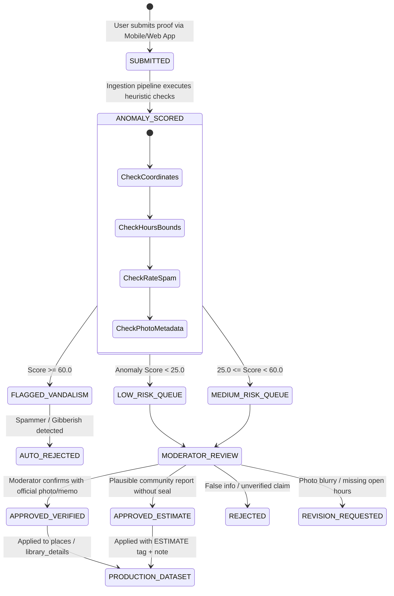

# Phase 2 Community Verification & Anomaly Detection Pipeline

> **Document ID:** B-M4-01  
> **Status:** Architecture Specification / Approved for Phase 2 Implementation  
> **Target Feature:** `F-102` (Community Verification & Crowdsourced Updates)  
> **Traceability Links:** `INV-001` (Zero Hallucination), `BR-001` (Tri-State Integrity), `T-004` (Spam & Rate Limiting), `T-005` (Audit Trail).

---

## 1. Executive Summary & Purpose

Phase 1 established an authoritative civic space and transit baseline using government and municipal open datasets (NLP, LGU reading center directories, LTFRB fare matrices, Copernicus Sentinel-2). However, local operating hours, air-conditioning availability, and desk capacity at barangay-level facilities change frequently without formal digital gazette updates.

`F-102` introduces crowdsourced community verification while maintaining **radical data honesty (`INV-001`)**. Under no circumstance will crowdsourced submissions ever automatically modify civic datasets or receive a `VERIFIED` tag without moderator cryptographic sign-off. This document specifies the multi-stage ingestion, automated anomaly scoring, and human-in-the-loop review architecture.

---

## 2. The Verification State Machine



---

## 3. Automated Heuristic Anomaly Scoring Engine

Every submission passes through an automated pipeline computing an **Anomaly Risk Score ($S \in [0.0, 100.0]$)**:

$$S = \min\left(100.0, \sum_{i=1}^{5} w_i \cdot P_i\right)$$

| Heuristic Penalty ($P_i$) | Weight ($w_i$) | Detection Mechanism & Thresholds |
|---|---|---|
| **1. Schedule Inversion / Unrealistic Hours ($P_1$)** | 35.0 | Triggered if `open_time >= close_time`, daily operating duration exceeds 16 hours, or facilities report 24/7 operations without official LGU ordinance. |
| **2. High-Frequency Spammer Burst ($P_2$)** | 25.0 | Triggered if contributor submits > 3 changes within 10 minutes or repeats identical edits across multiple LGUs. |
| **3. Photo Metadata Anomaly ($P_3$)** | 20.0 | EXIF metadata verification: flags downloaded stock images, screenshots without camera timestamp, or photos taken > 60 days prior to submission. |
| **4. Historical Contributor Trust Score ($P_4$)** | 15.0 | Inversely proportional to contributor reputation: new accounts receive +15 risk; accounts with 5+ approved edits receive 0 penalty. |
| **5. Civic Name / Text Heuristic ($P_5$)** | 5.0 | Natural language checks flagging profanity, marketing spam, or external commercial links. |

---

## 4. Cryptographic Moderator Approval Standard (`INV-001`)

To prevent unauthorized, rogue, or accidental dataset mutations, the production database enforces a cryptographic audit barrier:

1. **Digital Signature Requirement:** When an authorized moderator signs off on an approval via `POST /api/v2/admin/review/queue/{id}/decision`, the API gateway signs the approved payload with an asymmetric Ed25519 private key:
   ```json
   {
     "submission_id": "c1f7a0b3-6c7e-4d8a-9f5e-123456789abc",
     "moderator_id": "mod_pasig_edu_01",
     "action": "APPROVE_AS_VERIFIED",
     "timestamp": "2026-11-03T08:30:00Z",
     "ed25519_signature": "MEQCIFx18jZ..."
   }
   ```
2. **Database Constraint & Trigger:** Supabase PostgreSQL triggers verify that any update transitioning `verification_meta.status` from `ESTIMATE` or `PENDING` to `VERIFIED` contains a verified cryptographic signature from an authorized role in `user_profiles.role = 'moderator'`.
3. **Audit Trail Immutability:** All rejected, approved, or edited community contributions are permanently recorded in the append-only table `community_audit_log` with 7-year retention.

---

## 5. Storage & Free-Tier Budget Compliance

- **Photo Evidence Storage:** Contributor photos are uploaded to Cloudflare Images / Cloudflare R2 with aggressive WebP recompression (average 150KB per proof image).
- **Quota Bounds:** Free-tier Cloudflare R2 allocation (10GB) accommodates **over 65,000 community verification photo proofs** before requiring tier upgrades.
- **Auto-Purge for Rejected Submissions:** Photos attached to rejected vandalism submissions are automatically purged from R2 storage after 14 days.
