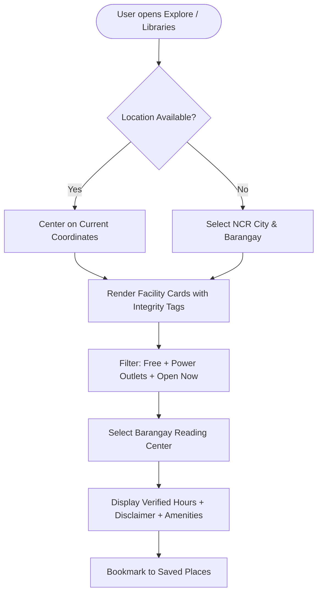
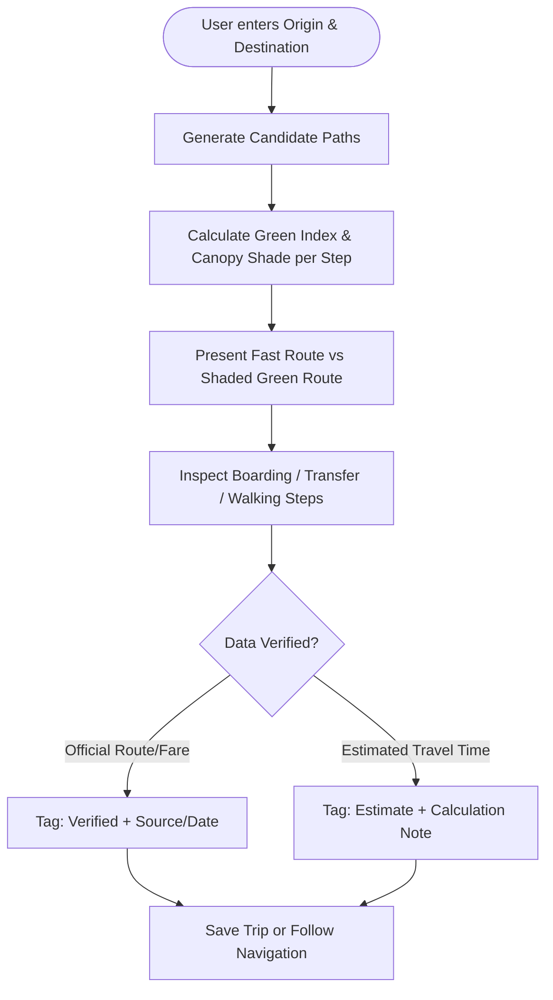

# PRD — Product Requirements Document: Lunhaw

> **Purpose:** Product specifications for Lunhaw, translating civic and commuter needs into functional requirements. Serves as the primary reference for architecture, implementation, and quality assurance.
> Traces back to: [idea.md](idea.md), [context.md](context.md). Traces forward to: [system-design.md](system-design.md), [data-model.md](data-model.md), [api-spec.md](api-spec.md), [qa-test-plan.md](qa-test-plan.md).

## Overview & goals
Lunhaw is a public-spaces and green-mobility platform for Metro Manila (NCR), Philippines. It connects urban residents with nearby parks, gardens, municipal libraries, and barangay reading centers while enabling greener, shaded commutes. The core goal is breaking the monotonous "work/school–traffic–home" loop through transparent discovery without ever fabricating civic data.

## Personas & use cases

### Persona 1: Mika, 20 — State University Student (Manila / U-Belt)
- **Context:** Commutes daily from a rented dorm; needs quiet, well-ventilated, free spaces with power outlets to study for examinations.
- **Pain Point:** Commercial coffee shops cost 150–300 PHP per visit; university library seats fill up by 8:00 AM; unaware that a quiet barangay reading center exists 400 meters away.
- **Use Case:** Filters facilities by "Free", "Desk Space", "Power Outlets", checks verified operating hours, and walks there.

### Persona 2: Paolo, 28 — Commuter & Daily Walker (Ortigas / Mandaluyong)
- **Context:** Walks 1–2 km between transit stops and offices under harsh NCR sun and congested roadways.
- **Pain Point:** Navigation apps recommend unshaded concrete flyovers with high heat indexes and hallucinate jeepney arrival times.
- **Use Case:** Compares standard commute paths against high-shade green routes, reviewing clear walking steps and transparent transit estimates.

### Persona 3: Maria, 34 — Parent & Community Resident (Quezon City)
- **Context:** Wants safe, open outdoor areas for children to play during weekends without spending at shopping malls.
- **Pain Point:** Lack of centralized info on which pocket parks are maintained, open to the public, and stroller-accessible.
- **Use Case:** Browses local parks, views map previews and verified playground amenities, and saves favorites.

## User stories

### Explore & Libraries
- As a **student**, I want to search and filter public libraries and barangay reading centers by amenities (power outlets, Wi-Fi, air conditioning, study desks), so that I can find a suitable free place to study.
- As a **resident**, I want to view verified operating hours and access requirements (e.g. required IDs or dress codes), so that I don't travel to a facility only to find it closed or restricted.
- As a **user without GPS enabled**, I want to manually choose my City and Barangay, so that I can explore local facilities without sharing my live coordinates.

### Commute & Green Index
- As a **pedestrian**, I want to see a Green Index and shade score for my commute route, so that I can choose pathways with tree canopy cover during peak daylight hours.
- As a **transit commuter**, I want readable boarding, transfer, and alighting directions with clear distinction between official schedules and estimates, so that I can plan my travel realistically.

### Saved
- As a **returning user**, I want to bookmark places and save frequent transit routes, so that I can quickly reference them without re-entering search parameters.

## User journeys

- **UJ-001 — Discover Quiet Study Space:** Student opens Lunhaw &rarr; selects "Libraries & Reading Centers" filter &rarr; enters current neighborhood (or enables location) &rarr; reviews facility detail card with verified hours, desk capacity, and outlet availability &rarr; reads facility check disclaimer &rarr; saves place &rarr; navigates to destination.
- **UJ-002 — Shaded Commute Planning:** Commuter selects starting point and destination &rarr; reviews recommended walking + public transit route options &rarr; inspects Green Index breakdown showing tree canopy shade percentage &rarr; checks step-by-step transfer points &rarr; begins journey.
- **UJ-003 — Manual Area Discovery:** Resident disables browser geolocation &rarr; prompts Lunhaw manual entry &rarr; selects City (e.g. "Pasig City") and Barangay (e.g. "San Antonio") &rarr; system renders verified pocket parks and community reading centers located within that jurisdiction.

## Feature list (with priorities)

| F-ID | Feature | Priority | Solves (Problem) | Notes |
|---|---|---|---|---|
| **F-001** | Explore Directory & Map Previews | MVP | Civic space fragmentation; difficulty discovering nearby parks and open spaces. | Includes search, categorical filtering, and interactive map pins. |
| **F-002** | Public Libraries & Barangay Reading Centers | MVP | Absence of free, quiet study spaces for students; hidden municipal facilities. | Lists amenities, rules, access requirements, and verified schedules. |
| **F-003** | Commute & Walking Route Planner | MVP | Lack of walkable, shaded pathways and transparent transit directions. | Multi-modal walking + jeepney/bus/rail steps with boarding points. |
| **F-004** | Green Index & Canopy Shade Calculator | MVP | Urban heat island exposure; lack of environmental transparency. | Scores canopy cover and shade using open glass-box formulas. |
| **F-005** | Saved Places & Trips | MVP | Inconvenience of repeating frequent searches. | Local storage persistence with optional profile sync. |
| **F-006** | Manual Area Entry Fallback | MVP | Inability to access local info when GPS is unavailable or denied. | City & Barangay selector dropdowns. |
| **F-101** | Native Mobile App (iOS / Android) | Phase 2 | Mobile-first ergonomics and push notifications for route alerts. | Platform-neutral API integration. `[TBD]` |
| **F-102** | Community Verification Portal | Phase 2 | Stale civic hours and facility updates across 17 LGUs. | Moderated crowdsourcing pipeline. `[TBD]` |
| **F-103** | Offline Map & Route Caching | Phase 2 | Intermittent mobile data connectivity during transit. | Local cache storage for saved routes. `[TBD]` |

## Business rules

- **BR-001 (Data Integrity Tri-State):** Every single attribute regarding routes, fares, opening hours, or facility amenities MUST be explicitly tagged with one of three states:
  - `VERIFIED`: Confirmed by official LGU/facility source + carries a last-updated ISO 8601 date.
  - `ESTIMATE`: Derived via algorithm/heuristics + carries a mandatory explanatory note detailing the derivation.
  - `NOT_AVAILABLE`: Data is unconfirmed or absent; never filled with speculative defaults.
- **BR-002 (Verification Freshness):** A `VERIFIED` record older than 180 days triggers an internal review flag in the administrative audit queue.
- **BR-003 (Green Index Transparency):** Green Index scores MUST range from 0 to 100 and explicitly reveal the breakdown between measured canopy data and estimated environmental factors.
- **BR-004 (Graceful Geolocation Degradation):** If browser geolocation permission is denied, timed out, or unavailable, the application SHALL seamlessly transition to Manual Area Entry without error dialogues or degraded core features.
- **BR-005 (Mandatory Facility Notice):** Facility profiles MUST render a persistent notice advising users to confirm with the venue before travel.

## Hard rules / must-never (invariants — `INV-###`)

- **INV-001 (Zero Hallucination of Civic and Transit Data):** The system SHALL NEVER invent, hallucinate, or unreliably extrapolate routes, transit fares, operating hours, or facility amenities. IF an attribute is unknown or unverified, THEN the system SHALL label it `Not available yet` or provide an explicitly labelled `Estimate`. (Enforced by: Security Threat T-001, Banned Copy Rule 1, QA Negative Test TC-N01).
- **INV-002 (Mandatory Facility Verification Disclaimer):** The system SHALL NEVER render facility operating hours, study desk availability, or amenities without displaying the advisory disclaimer: *"Please verify operating hours and rules directly with the facility before visiting, as local barangay schedules may change without notice."* (Enforced by: Security Threat T-002, Banned Copy Rule 2, QA Negative Test TC-N02).
- **INV-003 (Platform-Neutral Core Architecture):** The system backend and domain models SHALL NEVER expose platform-specific dependencies or business logic restricted to a single client (Web vs. Mobile). All contracts SHALL remain platform-neutral JSON REST endpoints. (Enforced by: API Contract Linting, QA Contract Test TC-N03).

## User flows

### Flow 1: Study Space Discovery (UJ-001)

### Flow 2: Commute & Shade Route Planning (UJ-002)

## Acceptance criteria (EARS)

- **F-001 (Explore Directory):**
  - WHEN a user submits a search query or category filter, the system SHALL return matching public spaces within 500ms with interactive map pins and integrity tags.
- **F-002 (Libraries & Reading Centers):**
  - The system SHALL display study amenities (desks, power outlets, Wi-Fi, air conditioning) and operating hours for each facility with an explicit integrity badge (`Verified`, `Estimate`, or `Not available yet`).
  - IF a facility profile is rendered, THEN the system SHALL display the mandatory verification disclaimer (`INV-002`).
- **F-003 (Commute Planner):**
  - WHEN a user requests directions between two NCR coordinates or barangays, the system SHALL output sequential walking and transit steps including boarding/transfer points and fare tags.
  - The system SHALL NEVER display an estimated fare or schedule without marking it `Estimate` (`INV-001`).
- **F-004 (Green Index):**
  - WHEN displaying a green space or route, the system SHALL compute and show a Green Index score (0–100) alongside a glass-box methodology explainer detailing canopy coverage and measurement source.
- **F-005 (Saved Places & Trips):**
  - WHEN a user toggles the save icon on any place or route, the system SHALL immediately persist the record to local storage and update the saved badge count.
- **F-006 (Manual Area Entry):**
  - IF geolocation permission is denied or unavailable, THEN the system SHALL render a selector listing all 17 Metro Manila LGUs and their corresponding barangays.

## Non-goals
- In-app ticketing, digital fare payment processing, or ride-hailing booking.
- Real-time GPS fleet tracking of jeepneys or buses.
- User review forums, uncurated star ratings, or public comment boards.
- Commercial advertisements or sponsored business listings.

## Dependencies
- **Map & Geocoding Services:** OpenStreetMap (OSM) / Leaflet / MapLibre `[TBD: specific provider]`.
- **Canopy & Environmental Data:** Copernicus / Sentinel satellite canopy data or municipal environmental reports `[TBD]`.
- **Administrative Data:** NCR LGU directories and National Library of the Philippines (NLP) public library registries.

## Open questions `[TBD]`
- Selected production backend and database tech stack: `[TBD]`.
- Data licensing and update cadence agreements with NCR LGUs: `[TBD]`.
- Mobile app framework (React Native vs. Flutter) for Phase 2: `[TBD]`.
- Long-term hosting and maintenance funding model: `[TBD]`.
