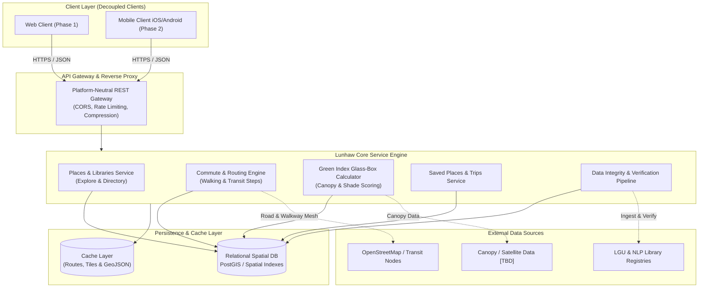

# System Design Document (HLD) — Lunhaw

> **Purpose:** High-level architectural specification for Lunhaw. Defines the platform-neutral backend and client layers, components, data flows, integration points, and trade-offs.
> Traces back to: [prd.md](prd.md), [idea.md](idea.md). Traces forward to: [data-model.md](data-model.md), [api-spec.md](api-spec.md), [security-compliance.md](security-compliance.md).

## Context diagram

## Components & responsibilities

| Component | Responsibility | Owned Domain | Dependencies |
|---|---|---|---|
| **Client Layer (Web & Mobile)** | Presentation, user geolocation permissions, manual LGU selector, interactive map rendering, client-side saved bookmarks. | UI/UX, Local state | API Gateway |
| **API Gateway** | Request authentication, rate limiting, payload validation, CORS policies, response caching. | Edge ingress | Core Services |
| **Places & Libraries Service** | Search, categorical filtering, facility profile queries, amenities inspection, operating hours. | `Place`, `Library`, `Amenity` | Spatial DB |
| **Commute & Routing Service** | Multi-modal route calculation (walking + supported public transit: jeepneys, buses, trains), transfer points, and fare calculation. | `Route`, `Leg`, `TransitStop` | Spatial DB, OpenStreetMap |
| **Green Index Engine** | Computes neighborhood and pathway canopy coverage and shade scores using glass-box equations (`EQ-001`, `EQ-002`). | `GreenIndex`, `CanopyMetric` | Spatial DB, Satellite datasets |
| **Data Integrity Service** | Enforces the three data states (`VERIFIED`, `ESTIMATE`, `NOT_AVAILABLE`), attaches sources/timestamps, and audits stale records. | `VerificationMeta`, `AuditLog` | Spatial DB |
| **Saved Places & Trips Service** | Handles user bookmarking, list management, and synchronization across devices. | `SavedItem`, `UserSession` | Spatial DB |

## Data flow

### 1. Facility Search with Verification Tags
1. Client issues `GET /api/v1/places?category=library&lgu=Manila&amenities=power,desks`.
2. API Gateway validates query parameters and passes request to Places Service.
3. Places Service executes indexed spatial query on PostgreSQL.
4. Data Integrity layer attaches `VerificationMeta` for each facility:
   - Sets label: `VERIFIED` with official source and date, or `NOT_AVAILABLE` if unconfirmed.
5. Injects mandatory facility check disclaimer into response payload.
6. JSON payload returned to client; client renders facility cards and map markers.

### 2. Shaded Commute Query
1. Client issues `POST /api/v1/commute/routes` with `origin`, `destination`, and `preference=shaded`.
2. Commute Service calculates candidate paths (walking + transit legs).
3. Green Index Engine queries canopy coverage overlay along the candidate route paths.
4. For each leg, computes tree shade coverage percentage and attaches calculation method note (`ESTIMATE`).
5. Labels transit fares: `VERIFIED` if official LTFRB/LRT fare matrix, or `ESTIMATE` with fare equation note.
6. Returns sorted routes to client with full transparency notes.

## Key technology choices + rationale

| Choice | Why | Trade-off Accepted | Alternative Rejected |
|---|---|---|---|
| **Platform-Neutral REST/JSON API** | Strict requirement that Web (Phase 1) and Mobile (Phase 2) share one backend with zero duplicated business logic. | Additional upfront serialization and schema contract rigor. | Direct client-to-DB or GraphQL with platform-coupled resolvers. |
| **PostgreSQL + PostGIS** `[TBD: specific host]` | Industry standard for geographic coordinates, spatial bounding box queries, and multi-modal routing graphs. | Requires relational schema migrations and spatial indexing discipline. | NoSQL document stores (weak spatial indexing and poor relational join performance). |
| **Stateless Micro-Services / Modular Monolith** | Clear separation between heavy GIS routing/green index calculations and lightweight directory lookups. | Slightly higher deployment coordination. | Heavy monolithic server with tightly coupled frontend rendering. |
| **Client-Side Fallback for Saved Items** | Instant offline availability and zero login friction for students looking to bookmark spots immediately. | Synchronization across multiple devices requires explicit account login later. | Forced account creation wall before allowing bookmarks. |

## Integration points

| Integration | Protocol | Purpose | Failure Mode & Recovery |
|---|---|---|---|
| **Map Tile Provider** (OSM / MapLibre) `[TBD]` | Vector/Raster Tiles (HTTPS) | Base map rendering on Web and Mobile clients. | Fallback to cached OpenStreetMap raster tiles; graceful list-view fallback if tiles fail. |
| **Public Transit Networks** (LTFRB, DOTr, LRT/MRT) | Periodic CSV/GTFS or manual batch ingest | Fixed route lines, fare matrices, and station coordinates. | Cached static routing graphs; if fare is unverified, tag explicitly as `Estimate` or `Not available yet`. |
| **Satellite Canopy Imagery** (Copernicus / Sentinel) `[TBD]` | GeoTIFF / GIS raster layers | Tree canopy and green space index baselines. | Precomputed static canopy tiles updated semi-annually; fallback to baseline district green ratios. |

## Implementation status (1.0, 2026-11-08)
What actually ships differs from the target design above in a few places:
- **Hosting:** Cloudflare Pages (static Next.js export) + Cloudflare Worker API + Supabase; no containers, VPC or Redis. The Worker caches reads in memory for 60 s; see [RELEASE.md](RELEASE.md).
- **Routing:** the 1.0 app gives straight-line walking estimates only. Transit routing and shade scoring exist in code but have no production data yet.
- **Access:** `/home` requires an account (see the decision ledger, 2026-11-08).

## Deployment topology
- **Staging / Production Environments:** Cloud container runtime (e.g. Docker / Kubernetes or serverless containers) `[TBD: provider]`.
- **Edge Layer:** CDN caching static assets, base map vector tiles, and unchanging municipal boundary geometries.
- **Data Boundary:** Production database isolated in a private VPC; public access restricted exclusively to the API Gateway.

## Scaling strategy
- **Read-Heavy Geographic Queries:** 95% of traffic consists of reading places, routes, and green index scores. Heavy spatial queries are cached in Redis keyed by geographic tile quadkeys or geohashes.
- **Green Index Precomputation:** Neighborhood green indexes and street canopy scores are precalculated during data ingest, eliminating on-the-fly raster image analysis during commuter requests.
- **Horizontal API Scaling:** Stateless API instances scale independently with CPU/memory load during morning and afternoon commute peaks.

## Trade-offs considered
- *Live GPS transit fleet tracking vs. Static network graph:* Metro Manila public transport currently lacks an open universal GPS API for jeepneys and UV Express. Attempting to simulate real-time bus arrivals would violate `INV-001` (zero hallucination). We explicitly accepted static route paths with clear estimation intervals.
- *Forced Authentication vs. Open Access:* Requiring user accounts would reduce friction for students in need of instant study space lookups. We chose open unauthenticated access for search, commute, and local bookmarks, reserving authentication strictly for administrative verification.
